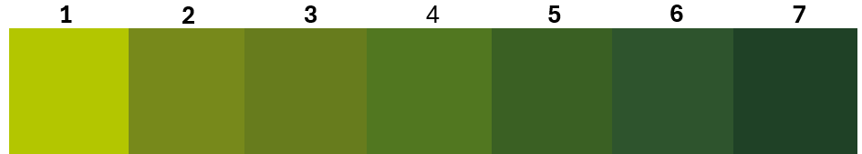

# Plant Health Monitoring: Plan

Status: **design agreed in outline, waiting on answers from Jason before building.**
It will be a separate section of the same app, as Jason asked: one app, mites first,
plant health later, different people, data not plotted together.

## What is recorded (from Jason)

Season: **October to April**. The same plants are visited every week, **14 plants
per block**, identified by block, **row** and plant number.

**One-off dates** (recorded once per season):

- Emergence of first leaf
- Burn-off spray
- First train
- Second train
- Lateral development
- Burr initiation
- Cone initiation

**Weekly measurements** (recorded every visit):

- Leaf colour, picked from the swatch scale below
- Length of average vine up the string
- Internode spacing (top one)
- Lateral length
- Weight of 10 cones

## Leaf colour scale

The farm's chart, with exact colours taken from it:

| Score | Colour |
|---|---|
| 1 | `#b3c600` (yellow-green) |
| 2 | `#77891b` |
| 3 | `#677c1d` |
| 4 | `#517720` |
| 5 | `#3a6023` |
| 6 | `#2e542d` |
| 7 | `#1f4126` (darkest green) |

The score (1–7) is what's stored and exported. In the app each swatch is a large
tap target showing its number, so the choice doesn't rely on colour alone.

## Where the data lives

Plant health data goes in its **own Google Sheet** ("Hop Farm – Plant Health"),
separate from the mite sheet ("Hop Farm Data"). It is still the same app, with one
sign-in:

- The existing Apps Script opens the plant sheet by its ID (a single setting,
  `PLANT_HEALTH_SHEET_ID`) and writes the Plants, PlantMilestones and
  PlantInspections tabs there.
- Users, roles and the block list stay in the mite sheet, so staff are managed in
  one place. Each user gets access to Mite Monitoring, Plant Health or both.
- Each sheet can be shared with different people. The script owner needs edit
  access to both.
- Exports, version history and season archiving are per sheet.

## Proposed design

**Tabs in the Plant Health sheet:**

| Tab | One row per | Columns |
|---|---|---|
| Plants | monitored plant (set up once) | PlantID, BlockVarietyID, Block, Variety, Row, PlantNumber, WalkOrder, Active, Notes |
| PlantMilestones | plant (or block, see Q2) per season | Season, PlantID, FirstLeafDate, BurnOffSprayDate, FirstTrainDate, SecondTrainDate, LateralDevelopmentDate, BurrInitiationDate, ConeInitiationDate |
| PlantInspections | plant per visit | InspectionID, PlantID, InspectionDate, Season, InspectorEmail, LeafColour (1–7), VineLength, InternodeSpacing, LateralLength, Cone10Weight, Comment, Photo |

**App**

- *Weekly round:* choose a block, then go plant by plant in walking order and
  press **Save & next plant**. Works offline, like the mite samples.
- *Milestones:* a **Seen today** button for each one not yet reached. Once
  recorded it's locked in and no longer asked.
- *Access:* users get Mite Monitoring, Plant Health, or both.
- *Reports:*
  - weekly growth charts per block (vine length, internode spacing, lateral length, leaf colour)
  - milestone timing per block
  - CSV for Excel

## Open questions (sent to Jason)

1. Which blocks are monitored: all 39 block/varieties (about 550 plants a week) or a selection?
2. Are burn-off spray and the two training dates per block rather than per plant?
3. ~~Leaf colour scale~~: **answered**, the 7-step chart above.
4. Units: vine length (cm or m), internode spacing (mm or cm), lateral length (cm), cone weight (g, fresh?).
5. Is "average vine length" the average of the bines on a plant's string, or one measurement?
6. Should cone weight only be asked for after cone initiation?
7. Anything else weekly, e.g. pest or disease notes, or a photo?
