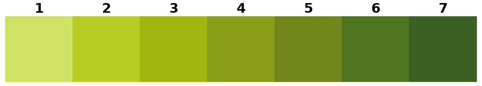

# Plant Health Monitoring

Status: **built (app version 1.2.0)**, following Jason's paper form "Hop Plant Weekly
Monitoring Report" (Version 1, Nov 2026, `Crop_monitoring_Forms_2026.xlsx`).

## How it works

- **One plant check = one bay** (the 7 plants between two posts) on one visit,
  located by **block/variety, Row # and Bay # (from south)**.
- **Inspector, date and time** fill in automatically from the sign-in.
- The **server numbers records per season** (e.g. *2026/27 #5*), like the paper
  form's record numbers, so two tablets never clash.
- Works **offline** and syncs later, like mite samples.
- The person who made a check can correct it for **31 days**. Administrators can
  change any check.
- Each user can be given **Mite Monitoring, Plant Health, or both** (Manage
  Users → *Can use*). Existing users keep both.

### The form

| Section | In the app |
|---|---|
| 1. Sample details | Block & variety (same list as mites), Row #, Bay #, date, time, inspector. Shows the last check of that block and fills in its row and bay. |
| General weather & block conditions | **Not in the app.** Comes from the weather station and soil probes. |
| 2. Block overview | Bine health, Coir status, Weed pressure, Grass length, Trellis integrity, Irrigation leaks as tap choices, plus a photo. |
| Block treatments | **Not in the app.** Comes from other records. |
| 3. Crop phenology | One required choice of the 7 growth stages. |
| 4. Vine evaluation | Bines on string (/42), average and maximum bine height (cm), internode spacing (<1 m, 1–2 m, 2–3 m), average lateral length, snapped tips (bine / lateral), overall bine health, leaf colour (7-step chart), leaf size, leaf damage (tick all that apply), 2 leaf photos. |
| Comments | Free text. |

**When questions are asked** (from the form's notes):
- Internode <1 m: until the average height passes 2 m.
- Internode 1–2 m: once the average passes 2 m.
- Internode 2–3 m: once the average passes 3 m.
- Lateral length: from the *Lateral Development* stage on.

Questions that don't apply are saved blank.

**Checks:** the tallest bine can't be shorter than the average; bines on string is
0–42; whole numbers where the form expects counts.

### Leaf colour scale

7 steps from light yellow-green (1) to mid green (7). The score 1–7 is saved.
Changed in Nov 2026: colour 1 was made lighter and the old 5 became 7, with
the steps in between evenly spaced. The two darkest greens were dropped.

| Score | 1 | 2 | 3 | 4 | 5 | 6 | 7 |
|---|---|---|---|---|---|---|---|
| Colour | `#d0e263` | `#b9cc26` | `#a1b40f` | `#8a9d18` | `#73861c` | `#4f7520` | `#3a6023` |

## Data

Stored in its own **Hop Farm – Plant Health** Google Sheet (tab `PlantChecks`),
connected with **Hop Farm → Connect Plant Health sheet…**. Users and blocks come
from the shared **Users & Setup** sheet.

## Reports

- **Growth week by week:** bar charts per block, one bar per check: average and
  maximum height, bines on string, internode spacing, lateral length, leaf colour.
- **When each stage was first recorded:** a block × stage table for the season.
- **Plant checks CSV:** one row per check, with a WeekStarting column for Excel
  PivotTables. Also available from the sheet: **Hop Farm → Build plant checks export**.

## Help

The 16 reference pictures from the workbook's Photos tab are in **Help → Plant
health**, and are available offline: nitrogen, phosphorus, potassium, calcium,
magnesium, sulphur, boron, chlorine, copper, iron, manganese, molybdenum and
zinc deficiencies, plus hop aphids.

## Still to confirm with Jason

1. How many bays per block each week, and which blocks are monitored.
2. Whether internode 1–2 m should also stop once the average passes 3 m (as <1 m does at 2 m).
